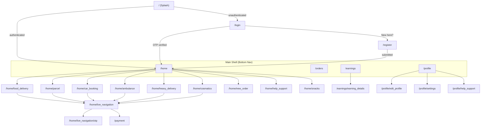
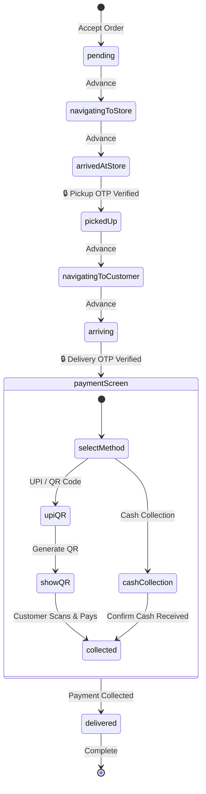
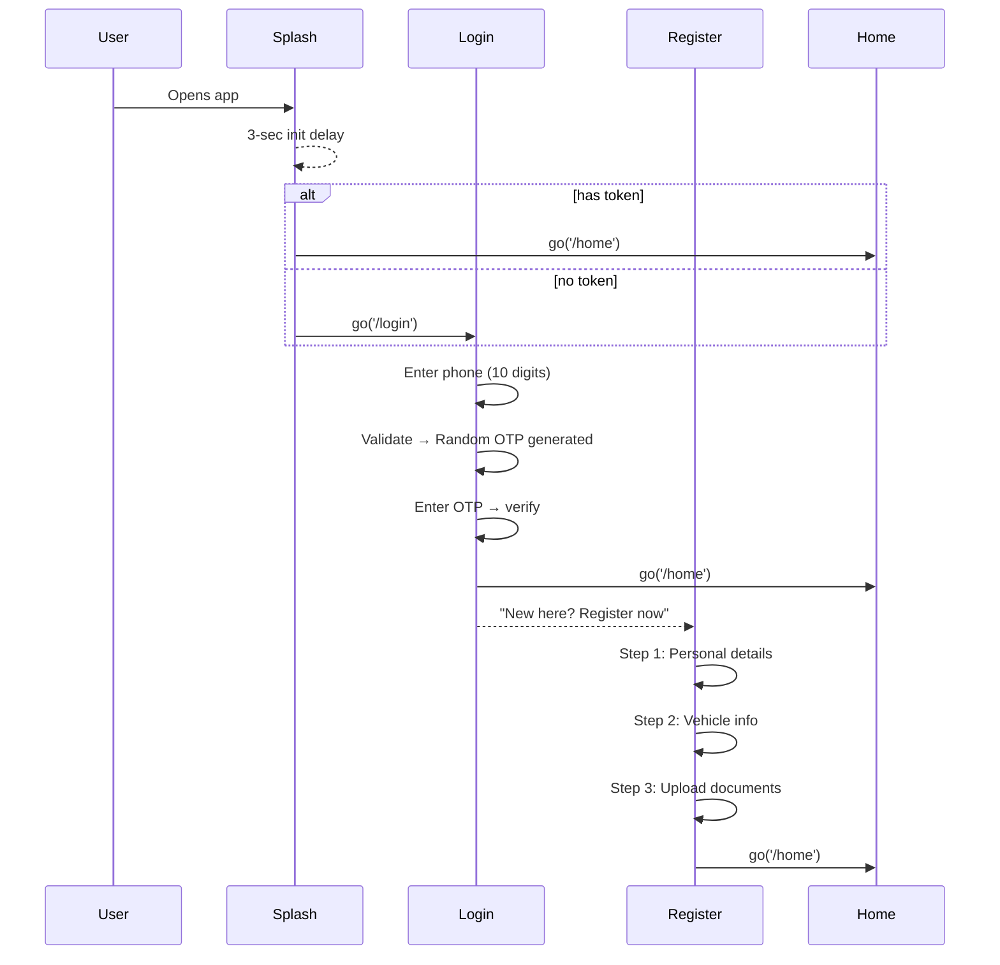

# 🛵 Bhukk Delivery — Rider Partner App

A premium Flutter delivery-partner application with modern design aesthetics, rich animations, and clean architecture. Built with **Riverpod** for state management, **GoRouter** for navigation, and **Mapbox** for live GPS navigation.

---

## ✨ Key Features

| Feature | Description |
|---|---|
| **Authentication** | Phone + 6-digit OTP login with random OTP generation per attempt |
| **Rider Registration** | 3-step form: Personal → Vehicle → Documents (image_picker + file_picker) |
| **Home Dashboard** | Service grid, aggregated stats, earnings overview, weekly chart |
| **Multi-Service Dashboards** | Dedicated dashboards for 6 delivery services with unique color themes |
| **Service Online/Offline** | Per-service rider status toggle — go online to start receiving orders |
| **Order Management** | New order requests with accept/decline, order history with filters |
| **Live Navigation** | Mapbox-powered GPS navigation with triple-layered route polyline |
| **Gyroscope Driver Marker** | Google Maps-style blue dot with vision cone that rotates with device |
| **OTP Verification** | 4-digit custom keypad for pickup/delivery verification |
| **Payment Collection** | UPI QR code generation + Cash on Delivery for customer payments |
| **Promo Ads** | Animated ad carousel on every service screen with auto-scroll |
| **Earnings** | Breakdown, charts, transaction history with pie chart details |
| **Profile** | Photo upload (camera/gallery), vehicle info, document status, edit profile |
| **Help & Support** | FAQ accordion, quick topics, emergency SOS, contact options |
| **Dark Mode** | Full dark/light theme with context-aware color system |
| **Voice Navigation** | TTS-based turn-by-turn voice instructions during delivery |

---

## 🚀 Multi-Service Delivery Platform

Bhukk Delivery supports **6 independent delivery verticals**, each with its own dashboard, stats, earnings, and action cards:

| Service | Color Theme | Dashboard Route | Key Features |
|---|---|---|---|
| 🍔 **Food Delivery** | Orange `#FF6B35` | `/home/food_delivery` | Restaurant pickups, cuisine-based orders |
| 📦 **Parcel** | Blue `#4A90D9` | `/home/parcel` | Package delivery, weight-based pricing |
| 🚗 **Car Booking** | Indigo `#5C6BC0` | `/home/car_booking` | Ride requests, passenger transport |
| 🚑 **Ambulance** | Red `#EF5350` | `/home/ambulance` | Emergency medical transport, priority routing |
| 🚛 **Heavy Delivery** | Teal `#26A69A` | `/home/heavy_delivery` | Furniture, appliances, bulk cargo |
| 💄 **Cosmetics** | Pink `#EC407A` | `/home/cosmatics` | Beauty & cosmetics delivery |

Each dashboard includes:
- **Header Card** — Service branding with gradient hero icon
- **Stats Card** — Today's deliveries, completion rate, active orders
- **Earnings Card** — Revenue breakdown with gradient indicators
- **Actions Card** — Service-specific quick action tiles
- **Promo Ads Card** — Animated promotional ad carousel

---

## 💳 Payment Collection System

The payment screen handles **driver-to-customer payment collection** at delivery time:

| Method | Description | Restriction |
|---|---|---|
| **UPI / QR Code** | Generates a real scannable UPI deep-link QR via `qr_flutter` | Available for all orders |
| **Cash Collection** | Driver collects cash from customer on delivery | ❌ Disabled for liquor orders |

### Payment Flow
```
Complete Delivery → Payment Screen → Select Method → Collect Payment → Done
                                          ↓
                                  UPI: Shows QR code (customer scans)
                                  Cash: Confirm cash collection
```

The UPI QR encodes: `upi://pay?pa=<merchant_vpa>&pn=Bhukk Delivery&am=<amount>&cu=INR`

---

## 🗺️ Live Navigation (Mapbox)

The live navigation screen provides real-time GPS-based delivery navigation:

| Feature | Implementation |
|---|---|
| **Map Engine** | Mapbox Maps Flutter SDK |
| **Route Rendering** | Triple-layered polyline (dark border → white outline → blue core) |
| **Driver Marker** | Google Maps-style blue dot with gyroscope-driven vision cone |
| **Destination Marker** | Styled pin markers for pickup & dropoff |
| **GPS Tracking** | Real-time location via `geolocator` |
| **Compass** | Device heading via `flutter_compass` for marker rotation |
| **Voice Navigation** | Turn-by-turn TTS instructions via `flutter_tts` |
| **Route API** | Mapbox Directions API for route geometry |

---

## 🏗️ Architecture

### Design Pattern: Feature-First with Unidirectional Data Flow

```
┌─────────────────────────────────────────────────────────┐
│                    UI LAYER (screen/)                    │
│         Screens → build() watches providers             │
│              ↕  (ref.watch / ref.listen)                │
│                  CARD LAYER (cards/)                     │
│         Reusable UI components per screen               │
├─────────────────────────────────────────────────────────┤
│                STATE LAYER (providers/)                  │
│     NotifierProvider<Notifier, State> declarations       │
├─────────────────────────────────────────────────────────┤
│              BUSINESS LOGIC (notifiers/)                 │
│    Notifier subclasses manage state + side effects       │
├─────────────────────────────────────────────────────────┤
│               DESIGN SYSTEM (theme/)                    │
│         C.of(context) — colors, spacing, styles         │
├─────────────────────────────────────────────────────────┤
│              NAVIGATION (routes/)                       │
│        GoRouter + StatefulShellRoute for tabs            │
└─────────────────────────────────────────────────────────┘
```

### State Management: Riverpod

Every feature follows this pattern:

```
notifiers/<feature>/<feature>_notifier.dart   ← State class + Notifier logic
providers/<feature>/<feature>_provider.dart   ← NotifierProvider<T, S> declaration
```

**Data flows one way:** `Notifier → State → Provider → UI (ref.watch)`
**Events go up:** `UI → ref.read(provider.notifier).doSomething()`

---

## 📂 File Structure

```
lib/
├── main.dart                                  # App entry (ProviderScope + MaterialApp.router)
│
├── routes/
│   └── app_router.dart                        # GoRouter config — all routes defined here
│
├── theme/
│   └── app_theme.dart                         # C.of(context), AppColors, AppTextStyles,
│                                              # AppSpacing, AppRadius, AppDecorations
│
├── screen/                                    # ── SCREENS ──
│   ├── splash_screen/                         # 3-sec splash → /login or /home
│   ├── login_screen/                          # 2-step: phone → OTP → /home
│   ├── register_screen/                       # 3-step stepper: Personal → Vehicle → Docs
│   ├── main_shell.dart                        # StatefulShellRoute + BottomNavBar
│   ├── home_screen/                           # Main dashboard with service grid
│   ├── food_delivery_screen/                  # 🍔 Food delivery service dashboard
│   ├── parcel_screen/                         # 📦 Parcel service dashboard
│   ├── car_booking_screen/                    # 🚗 Car booking service dashboard
│   ├── ambulance_screen/                      # 🚑 Ambulance service dashboard
│   ├── heavy_delivery_screen/                 # 🚛 Heavy delivery service dashboard
│   ├── cosmatics_screen/                      # 💄 Cosmetics service dashboard
│   ├── beverages_screen/                      # 🍺 Beverages / liquor dashboard
│   ├── orders_screen/                         # Order history + filter chips
│   ├── earnings_screen/                       # Earnings overview
│   ├── earning_details_screen/                # Pie chart + transaction history
│   ├── profile_screen/                        # Photo, personal, vehicle, docs
│   ├── edit_profile_screen/                   # Editable form with doc upload
│   ├── new_order_request_screen/              # Accept/decline incoming orders
│   ├── live_navigation_screen/                # Mapbox delivery navigation with GPS
│   ├── otp_screen/                            # 4-digit OTP for pickup/delivery
│   ├── payment_screen/                        # 💳 UPI QR + Cash collection screen
│   ├── snacks_inventory_screen/               # Staggered grid of snack items
│   ├── help_support_screen/                   # FAQ, SOS, contact options
│   └── settings_screen/                       # App settings
│
├── cards/                                     # ── REUSABLE UI CARDS (per screen) ──
│   ├── home/
│   │   ├── header_card.dart                   # Greeting + notification bell
│   │   ├── service_grid_card.dart             # Grid of 6 delivery services
│   │   ├── service_status_card.dart           # Online/offline toggle per service
│   │   ├── service_category_card.dart         # Service category navigation
│   │   ├── aggregated_stats_card.dart         # Combined stats across services
│   │   ├── status_card.dart                   # Global online/offline toggle
│   │   ├── live_activity_card.dart            # Current active delivery
│   │   ├── active_order_card.dart             # Active order summary
│   │   ├── delivery_stats_card.dart           # Today's stats
│   │   ├── earnings_card.dart                 # Today's earnings
│   │   ├── weekly_chart_card.dart             # 7-day bar chart
│   │   ├── promo_ads_card.dart                # 🎯 Animated promotional ad carousel
│   │   ├── new_order_popup_card.dart          # New order overlay notification
│   │   └── quick_actions_card.dart            # Navigate, snacks, support shortcuts
│   ├── food_delivery_screen/                  # Food delivery specific cards
│   │   ├── food_delivery_header_card.dart
│   │   ├── food_delivery_stats_card.dart
│   │   ├── food_delivery_earnings_card.dart
│   │   ├── food_delivery_actions_card.dart
│   │   ├── food_take_order_card.dart
│   │   └── food_history_card.dart
│   ├── parcel_screen/                         # Parcel specific cards
│   ├── car_booking_screen/                    # Car booking specific cards
│   ├── ambulance_screen/                      # Ambulance specific cards
│   ├── heavy_delivery_screen/                 # Heavy delivery specific cards
│   ├── cosmatics_screen/                      # Cosmetics specific cards
│   ├── payment_screen/                        # 💳 Payment collection cards
│   │   ├── order_summary_card.dart            # Order details breakdown
│   │   ├── payment_method_card.dart           # UPI/Cash method selector
│   │   ├── upi_qr_card.dart                  # Scannable UPI QR code display
│   │   └── pay_button_card.dart               # Collect payment action button
│   ├── live_navigation_screen/                # Navigation cards
│   │   ├── map_hero_card.dart                 # Mapbox map with route overlay
│   │   ├── delivery_timeline_card.dart        # Step indicator for delivery phases
│   │   ├── route_details_card.dart            # Distance/time/address info
│   │   ├── customer_info_card.dart            # Customer name + phone
│   │   ├── live_stats_bar_card.dart           # Compact delivery stats
│   │   └── navigation_actions_card.dart       # Primary action (OTP-gated → Payment)
│   ├── login_screen/                          # Phone + OTP cards
│   ├── register_screen/                       # Registration step cards
│   ├── otp_screen/                            # Pin field + keypad
│   ├── profile_screen/                        # Profile display cards
│   ├── edit_profile_screen/                   # Editable profile cards
│   ├── earning_details_screen/                # Charts + transaction cards
│   ├── orders_screen/                         # Order list + filter cards
│   ├── snacks_inventory_screen/               # Snack item cards
│   └── help_support_screen/                   # FAQ + SOS cards
│
├── notifiers/                                 # ── BUSINESS LOGIC ──
│   ├── splash_screen/                         # SplashStatus: loading → authenticated
│   ├── login_screen/                          # 2-step login: phone → OTP verify
│   ├── register_screen/                       # 3-step registration
│   ├── home_screen/
│   │   ├── rider_notifier.dart                # Online/offline toggle, rider stats
│   │   └── order_popup_notifier.dart          # Incoming order simulation + accept/reject
│   ├── food_delivery_screen/                  # Food delivery order logic
│   ├── parcel_screen/                         # Parcel order logic
│   ├── car_booking_screen/                    # Car booking order logic
│   ├── ambulance_screen/                      # Ambulance order logic
│   ├── heavy_delivery_screen/                 # Heavy delivery order logic
│   ├── cosmatics_screen/                      # Cosmetics order logic
│   ├── beverages_screen/                      # Beverages/liquor order logic
│   ├── orders_screen/                         # Order list with filter + accept/reject
│   ├── active_delivery_screen/                # Delivery status machine + OTP gates
│   ├── otp_screen/                            # 4-digit OTP input + verify
│   ├── payment_screen/                        # 💳 Payment methods + collection logic
│   ├── profile_screen/                        # UserProfile with photo/docs
│   ├── edit_profile_screen/                   # Editable profile form state
│   ├── snacks_inventory_screen/               # CRUD for snack items
│   ├── help_support_screen/                   # FAQ data + contact actions
│   ├── service_screen/                        # Service management
│   └── theme/                                 # Dark/light mode toggle
│
├── providers/                                 # ── PROVIDER DECLARATIONS ──
│   ├── splash/                                ├── ambulance/
│   ├── login/                                 ├── beverages/
│   ├── register/                              ├── car_booking/
│   ├── home/                                  ├── cosmatics/
│   ├── orders/                                ├── food_delivery/
│   ├── new_order/                             ├── heavy_delivery/
│   ├── delivery/                              ├── parcel/
│   ├── otp/                                   ├── payment/
│   ├── profile/                               ├── service/
│   ├── edit_profile/                          ├── snacks_inventory/
│   ├── help_support/                          └── theme/
│
├── models/                                    # ── DATA MODELS ──
│   ├── active_delivery.dart                   # Delivery state + serviceType + orderAmount
│   ├── order_request.dart                     # Incoming order request
│   ├── food_order.dart                        # Food order model
│   ├── parcel_order.dart                      # Parcel order model
│   ├── cab_order.dart                         # Cab booking model
│   ├── ambulance_order.dart                   # Ambulance order model
│   ├── cosmatics_order.dart                   # Cosmetics order model
│   ├── route_result.dart                      # Route geometry + distance/duration
│   ├── app_notification.dart                  # Notification model
│   └── snack_item.dart                        # Snack inventory item
│
├── services/                                  # ── EXTERNAL SERVICES ──
│   ├── map_service.dart                       # Mapbox route fetching + polyline rendering
│   ├── location_service.dart                  # GPS location tracking via geolocator
│   └── overlay_service.dart                   # System overlay window management
│
└── widgets/                                   # ── SHARED WIDGETS ──
    ├── bottom_nav_bar.dart                    # Custom animated bottom nav
    ├── delivery_overlay.dart                  # Active delivery floating overlay
    └── notification_panel.dart                # Slide-down notification list
```

---

## 🔀 Navigation Flow



---

## 🚚 Delivery + Payment Flow

The complete delivery flow from order acceptance to payment collection:



- 🔒 = OTP-gated transitions push to `/home/live_navigation/otp`
- OTP is randomly generated (4-digit) per delivery attempt
- After final OTP verification → navigates to **Payment Screen**
- Cash collection is **disabled for liquor orders** (UPI only)

---

## 🔐 Authentication Flow



---

## 🎯 Promo Ads System

Every service dashboard includes an animated promotional ads card:

- **Auto-scrolling carousel** with smooth page transitions
- **Gradient backgrounds** with unique color schemes per ad
- **CTA buttons** for ad interaction
- **Page indicators** with animated dot transitions
- Supports any content: promotional banners, partner ads, seasonal offers

---

## 🎨 Design System (`app_theme.dart`)

### Context-Aware Colors

```dart
final colors = C.of(context);   // auto light/dark
colors.background                // Surface background
colors.textPrimary               // Primary readable text
colors.surfaceElevated           // Card surfaces
colors.card                      // BoxDecoration preset
colors.cardShadow(0.04)          // Dynamic shadow
```

### Spacing Scale

| Token | Value | Usage |
|---|---|---|
| `AppSpacing.xs` | 4 | Tight gaps |
| `AppSpacing.sm` | 8 | Label spacing |
| `AppSpacing.md` | 12 | Between elements |
| `AppSpacing.lg` | 16 | Section padding |
| `AppSpacing.xl` | 20 | Screen horizontal padding |
| `AppSpacing.xxl` | 24 | Section gaps |
| `AppSpacing.xxxl` | 32 | Large separators |
| `AppSpacing.huge` | 48 | Top padding / heroes |

### Typography (Google Fonts — Inter)

| Style | Size | Weight |
|---|---|---|
| `AppTextStyles.headingLg` | 28 | w900 |
| `AppTextStyles.headingMd` | 22 | w800 |
| `AppTextStyles.headingSm` | 18 | w700 |
| `AppTextStyles.bodyLg` | 16 | w600 |
| `AppTextStyles.bodyMd` | 15 | w500 |
| `AppTextStyles.bodySm` | 13 | w400 |
| `AppTextStyles.caption` | 12 | w400 |
| `AppTextStyles.overline` | 10 | w600 |

### Colors

| Token | Hex | Usage |
|---|---|---|
| `AppColors.primary` | `#6C5CE7` | Buttons, accents, gradient start |
| `AppColors.primaryAccent` | `#A29BFE` | Gradient end, pill badges |
| `AppColors.secondary` | `#FD7272` | Destructive, logout |
| `AppColors.success` | `#00C48C` | Online, verified, document uploaded |
| `AppColors.warning` | `#FFB946` | Pending states |
| `AppColors.error` | `#FF4757` | Validation errors |
| `AppColors.info` | `#54A0FF` | Dev hints, informational |

### Animation Principles

- **Staggered Entry** — Sequential fade-in + slide-up for screen elements
- **AnimatedSwitcher** — Cross-fade between UI states (phone→OTP, step changes)
- **Scale on Tap** — Micro-animation on interactive elements (0.96 scale)
- **Haptic Feedback** — `HapticFeedback.mediumImpact()` on primary actions
- **Shake on Error** — Horizontal shake animation for wrong OTP
- **AnimatedContainer** — Smooth color/size transitions for state changes
- **Pulsing Glow** — UPI QR card pulsing shadow animation

---

## 🧩 Adding a New Feature

Follow this checklist to add a new screen:

1. **Notifier** → `lib/notifiers/<feature>/<feature>_notifier.dart`
   - Define a `State` class with `copyWith()`
   - Create a `Notifier<State>` subclass

2. **Provider** → `lib/providers/<feature>/<feature>_provider.dart`
   ```dart
   final featureProvider = NotifierProvider<FeatureNotifier, FeatureState>(
     () => FeatureNotifier(),
   );
   ```

3. **Cards** → `lib/cards/<feature>/`
   - Break UI into reusable card widgets
   - Cards receive data via constructor, not `ref.watch`

4. **Screen** → `lib/screen/<feature>/<feature>_screen.dart`
   - `ConsumerStatefulWidget` for animations, `ConsumerWidget` for static
   - Use `ref.watch(provider)` in `build()`
   - Use `C.of(context)` for themed colors

5. **Route** → Add to `lib/routes/app_router.dart`

---

## 📦 Key Dependencies

| Package | Purpose |
|---|---|
| `flutter_riverpod` | State management |
| `go_router` | Declarative routing with bottom nav |
| `google_fonts` | Inter font family |
| `mapbox_maps_flutter` | Mapbox map rendering + navigation |
| `geolocator` | Real-time GPS location tracking |
| `flutter_compass` | Device heading for marker rotation |
| `flutter_tts` | Text-to-speech voice navigation |
| `qr_flutter` | UPI QR code generation |
| `fl_chart` | Bar/pie charts for earnings |
| `image_picker` | Camera + gallery photo picker |
| `file_picker` | PDF/image document upload |
| `flutter_dotenv` | Environment variable management |
| `http` | HTTP client for API calls |
| `url_launcher` | External app/URL launching |
| `permission_handler` | Runtime permissions |
| `flutter_overlay_window` | System overlay windows |
| `latlong2` | Coordinate handling |

---

## 🚀 Getting Started

```bash
# Clone
git clone <https://github.com/naiyo-24/BHUKK-DELIVERY-PARTNER-APPLICATION.git>
cd bhukkdelivery

# Set up environment
cp .env.example .env
# Add your MAPBOX_ACCESS_TOKEN to .env

# Install dependencies
flutter pub get

# Run
flutter run
```

**Minimum Requirements:** Flutter 3.x, Dart 3.x

---

## 📋 Current State

- **Authentication:** Mock (no backend). Phone validation is local, OTPs are randomly generated in-memory per attempt.
- **Data:** All mock data is hardcoded in notifiers. Replace with API calls when backend is ready.
- **Documents:** Files are picked from device storage but not uploaded to any server. Paths are stored in memory.
- **Maps:** Uses Mapbox Maps SDK with real GPS tracking. Route geometry fetched from Mapbox Directions API.
- **Payments:** UPI QR codes are generated using the `upi://pay` deep-link standard. Merchant VPA is a placeholder — replace with your actual VPA.
- **Ads:** Promo ads use hardcoded mock data. Connect to your ad network or CMS when ready.
- **Service Dashboards:** All 6 service dashboards use mock order/stats data. Wire to backend APIs for production.
